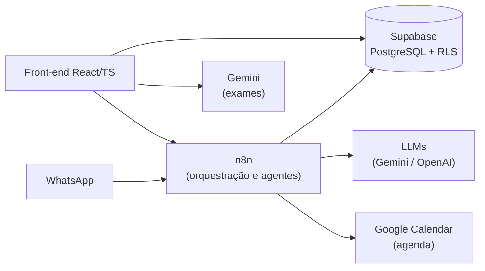

# 🏥 MedX 2.0 — CRM para Clínicas com IA e WhatsApp

> ⏸️ **Status: MVP Arquivado (Trade-offs de Infraestrutura & Custos).** O vídeo abaixo demonstra a versão funcional completa. O projeto foi pausado devido ao rápido consumo de armazenamento e requisições no Supabase (gravação contínua de áudios em base64, transcrições e logs de mensageria), o que exigiria a transição para planos pagos corporativos ou infraestrutura própria (PostgreSQL self-hosted + bucket S3 externo) que não justificavam o custo para a fase de testes. O repositório permanece público como documentação de arquitetura, modelagem SQL com RLS e interface.

## 🎥 Demonstração

👉 **[Assistir ao vídeo do MedX 2.0](https://drive.google.com/file/d/11y7Prq2dOGacBoZNM21hU4B9ZLbkeG9a/view?usp=sharing)**

## 🎯 Problema

Clínicas pequenas perdem tempo com tarefas repetitivas: responder WhatsApp, agendar, cobrar retorno, passar a consulta a limpo. O MedX junta CRM, atendimento por WhatsApp e assistentes de IA num só painel para médicos e secretárias.

## ⚙️ O que o MVP fazia

**Atendimento e agenda**
- Atendimento por WhatsApp distinguindo **lead** de **paciente já cadastrado**.
- Agendamento considerando turnos, pausas e **convênios aceitos por médico**.
- **Follow-up automático** de retorno (ex.: 7, 15, 30 dias), orquestrado no n8n.
- **Hand-off:** a IA pausa quando um humano assume a conversa.

**Assistentes de IA para o médico** (sempre como apoio, com validação humana)
- **Resumo da consulta:** transcrição do áudio e geração de resumo clínico estruturado na timeline do paciente.
- **Leitura de exames** (PDF/imagem) com Google Gemini.
- **Sugestão de CID e cálculo de dosagem** de medicamentos.

**Segurança**
- Autenticação via Supabase e **Row Level Security (RLS)**: médico e secretária só acessam o que o seu papel permite.
- Chaves de API fora do código (variáveis de ambiente / tabela de configuração).

## 🧱 Arquitetura



| Camada | Tecnologia |
|---|---|
| Front-end | React, TypeScript, Vite, Tailwind, shadcn/ui |
| Backend / dados | Supabase (PostgreSQL, Auth, RLS, Realtime) |
| Orquestração | n8n (webhooks, WhatsApp, agentes, agenda) |
| Agenda | Google Calendar (consultado e atualizado pelo n8n) |
| IA | Google Gemini, transcrição de áudio |

## 🤖 Como foi desenvolvido

Construído com **desenvolvimento assistido por IA**: Lovable para prototipar a interface e **Cursor** para evoluir o código. A pasta [`docs/`](./docs) guarda os registros de cada implementação e correção feitos durante o desenvolvimento.

## 🧠 O que aprendi

- Dividir responsabilidades: **front** só exibe, **n8n** orquestra, **banco** garante permissão (RLS).
- IA em saúde precisa de **humano no controle**: tudo que a IA sugere é revisado pelo médico.

### 🔄 O que eu faria diferente

O MedX foi construído com o **n8n como cérebro dos bastidores**. A maior parte da lógica que o usuário não vê roda nele: o atendimento pelo WhatsApp, os agentes de IA, os follow-ups e toda a **agenda**, incluindo as consultas e marcações no **Google Calendar**. O front-end basicamente exibe e dispara ações; quem decide o que acontece é o n8n.

Foi um projeto **grande e desafiador** de construir, e o n8n me surpreendeu: eu não esperava que uma ferramenta visual desse conta de tanta complexidade (turnos, pausas, convênios por médico, hand-off para humano, vários agentes conversando com o mesmo banco). Deu conta.

Com o que sei hoje, eu mudaria:
- **Arquitetura de armazenamento desacoplada (Object Storage vs. Banco):** Inicialmente, muitas cargas de áudio e anexos transitaram pesado pelo banco de dados. Em uma próxima versão, usaria um bucket S3/Cloudflare R2 direto para mídia pesada e manteria no banco apenas os metadados, evitando o estouro do limite de armazenamento do Supabase.
- **Versionar os fluxos do n8n** junto com o código (exportando os JSONs higienizados), mantendo um histórico reprodutível.
- **Quebrar os fluxos grandes em sub-fluxos modulares** (agenda, triagem clínica, follow-up), facilitando manutenção e testes unitários em nós críticos.

## 📁 Estrutura

```
src/          código do front-end
migrations/   migrações SQL do Supabase
seeds/        dados iniciais (sem chaves reais)
docs/         registros de implementação
```
