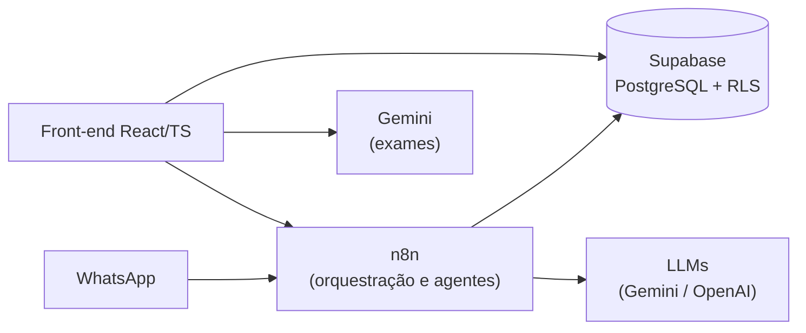

🏥 MedX 2.0 — CRM para Clínicas com IA e WhatsApp

⏸️ Status: MVP pausado. O vídeo abaixo mostra a versão funcional. Hoje o sistema não está no ar porque dependia de serviços externos (n8n, Supabase, WhatsApp) que foram desativados. O código fica aqui como registro do que foi construído.

🎥 Demonstração

👉 **[Assistir ao Vídeo de Demonstração do MedX 2.0](https://drive.google.com/file/d/11y7Prq2dOGacBoZNM21hU4B9ZLbkeG9a/view?usp=sharing)**

🎯 Problema

Clínicas pequenas perdem tempo com tarefas repetitivas: responder WhatsApp, agendar, cobrar retorno, passar a consulta a limpo. O MedX junta CRM, atendimento por WhatsApp e assistentes de IA num só painel para médicos e secretárias.

⚙️ O que o MVP fazia

Atendimento e agenda

Atendimento por WhatsApp distinguindo lead de paciente já cadastrado.
Agendamento considerando turnos, pausas e convênios aceitos por médico.
Follow-up automático de retorno (ex.: 7, 15, 30 dias), orquestrado no n8n.
Hand-off: a IA pausa quando um humano assume a conversa.

Assistentes de IA para o médico (sempre como apoio, com validação humana)

Resumo da consulta: transcrição do áudio e geração de resumo clínico estruturado na timeline do paciente.
Leitura de exames (PDF/imagem) com Google Gemini.
Sugestão de CID e cálculo de dosagem de medicamentos.[README.md](https://github.com/user-attachments/files/34605784/README.md)


Segurança

Autenticação via Supabase e Row Level Security (RLS): médico e secretária só acessam o que o seu papel permite.
Chaves de API fora do código (variáveis de ambiente / tabela de configuração).


🧱 Arquitetura


# 🏥 MedX 2.0 — CRM para Clínicas com IA e WhatsApp

> ⏸️ **Status: MVP pausado.** O vídeo abaixo mostra a versão funcional. Hoje o sistema não está no ar porque dependia de serviços externos (n8n, Supabase, WhatsApp) que foram desativados. <!-- TODO: confirme o motivo real --> O código fica aqui como registro do que foi construído.

## 🎥 Demonstração

👉 **[Assistir ao vídeo do MedX 2.0](https://drive.google.com/file/d/11y7Prq2dOGacBoZNM21hU4B9ZLbkeG9a/view?usp=sharing)**

## 🎯 Problema

Clínicas pequenas perdem tempo com tarefas repetitivas: responder WhatsApp, agendar, cobrar retorno, passar a consulta a limpo. O MedX junta CRM, atendimento por WhatsApp e assistentes de IA num só painel para médicos e secretárias.

## ⚙️ O que o MVP fazia

**Atendimento e agenda**
- Atendimento por WhatsApp distinguindo **lead** de **paciente já cadastrado**.
- Agendamento considerando turnos, pausas e **convênios aceitos por médico**.
- **Follow-up automático** de retorno (ex.: 7, 15, 30 dias), orquestrado no n8n.
- **Hand-off:** a IA pausa quando um humano assume a conversa.

**Assistentes de IA para o médico** (sempre como apoio, com validação humana)
- **Resumo da consulta:** transcrição do áudio e geração de resumo clínico estruturado na timeline do paciente.
- **Leitura de exames** (PDF/imagem) com Google Gemini.
- **Sugestão de CID e cálculo de dosagem** de medicamentos.

**Segurança**
- Autenticação via Supabase e **Row Level Security (RLS)**: médico e secretária só acessam o que o seu papel permite.
- Chaves de API fora do código (variáveis de ambiente / tabela de configuração).

## 🧱 Arquitetura



| Camada | Tecnologia |
|---|---|
| Front-end | React, TypeScript, Vite, Tailwind, shadcn/ui |
| Backend / dados | Supabase (PostgreSQL, Auth, RLS, Realtime) |
| Orquestração | n8n (webhooks, WhatsApp, agentes) |
| IA | Google Gemini, transcrição de áudio |

## 🤖 Como foi desenvolvido

Construído com **desenvolvimento assistido por IA**: Lovable para prototipar a interface e **Cursor** para evoluir o código. A pasta [`docs/`](./docs) guarda os registros de cada implementação e correção feitos durante o desenvolvimento.

## 🧠 O que aprendi

- Dividir responsabilidades: **front** só exibe, **n8n** orquestra, **banco** garante permissão (RLS).
- IA em saúde precisa de **humano no controle**: tudo que a IA sugere é revisado pelo médico.
- O que eu faria diferente: <!-- TODO: ex.: testes automatizados, menos dependência de serviços externos, deploy reproduzível com Docker -->

## 📁 Estrutura

```
src/          código do front-end
migrations/   migrações SQL do Supabase
seeds/        dados iniciais (sem chaves reais)
docs/         registros de implementação
```


Quer entender a fundo como essa arquitetura foi desenhada ou discutir a implementação da orquestração de IA na prática? **Vamos conversar:**

[](https://wa.me/555399364186)
[](https://www.linkedin.com/in/gabriel-freitas-elumina/)

---

> _"O futuro da saúde digital não está em substituir o médico, mas em eliminar o atrito operacional e o trabalho repetitivo. O MedX 2.0 é a aplicação prática da Inteligência Artificial como uma extensão da capacidade de atendimento humano."_
